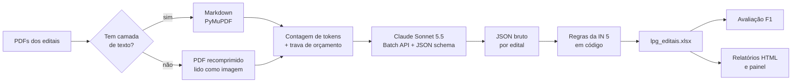
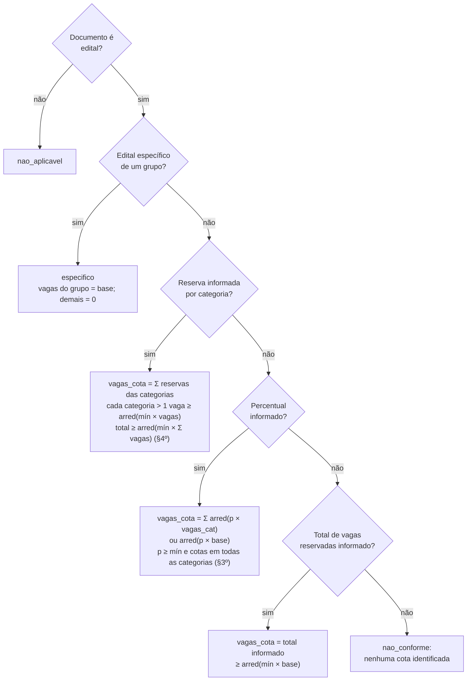
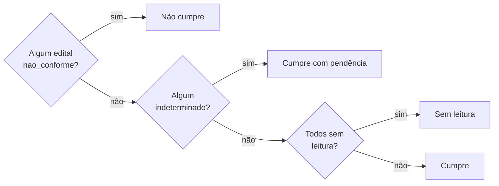
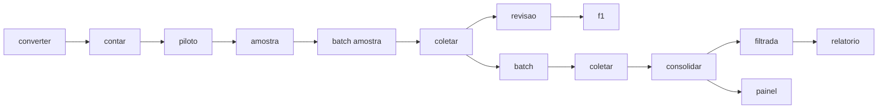

# Ações Afirmativas na Lei Paulo Gustavo

Metodologia de extração e tratamento de dados usada para verificar as cotas nos editais de fomento dos Estados, do Distrito Federal e das Capitais publicados com recursos da **Lei Complementar nº 195/2022 (Lei Paulo Gustavo, LPG)**.

O repositório reúne o código completo do pipeline: da leitura dos PDFs dos editais à planilha final, aos relatórios e ao painel. Os editais, as extrações e os resultados **não** estão versionados (ver [Dados](#dados)).

## Objetivo

Verificar se cada edital cumpre o art. 5º da [Instrução Normativa MinC nº 5/2023](https://www.in.gov.br/en/web/dou/-/instrucao-normativa-minc-n-5-de-10-de-agosto-de-2023-502407937):

| Dispositivo | Conteúdo |
|---|---|
| caput | mínimo de **20%** das vagas para pessoas negras e **10%** para pessoas indígenas |
| §2º | fração ≥ 0,5 arredonda para cima; < 0,5 para baixo |
| §3º | edital com categorias deve ter cotas em **todas** elas |
| §4º | categoria com 1 vaga pode ir à ampla concorrência, desde que o edital some 20% e 10% |

## Princípio da metodologia

A leitura dos editais e a aplicação da norma são separadas:

- **O modelo de linguagem só extrai.** Cada edital é lido inteiro pelo Claude, que devolve um JSON validado por schema, com trecho literal e página como evidência de cada campo. O prompt proíbe calcular ou estimar valores que o edital não traz.
- **As regras da IN 5 são aplicadas em código** (`transform/conformidade.py`), de forma determinística e coberta por testes.
- **A qualidade da extração é medida** contra um gabarito manual de cerca de 20% da base, com precisão, revocação e F1 por campo.

## Estrutura do projeto

```
.
├── README.md
├── LICENSE
├── requirements.txt               # dependências com versões fixadas
├── .env.example                   # modelo das variáveis de ambiente (copiar para src/.env)
├── src/
│   ├── main.py                    # orquestrador: cada etapa é um subcomando
│   ├── config/
│   │   └── settings.py            # caminhos, modelo, orçamento, mínimos da IN 5, códigos IBGE
│   ├── extract/
│   │   └── pdf_to_md.py           # etapa 1: PDF → Markdown (ou PDF recomprimido) + manifesto
│   ├── llm/
│   │   ├── prompt.py              # instruções de extração (versionadas em PROMPT_VERSION)
│   │   ├── schema.py              # schema Pydantic da saída (estrutura do JSON)
│   │   ├── extractor.py           # contagem de tokens, chamadas síncronas e Batch API
│   │   └── budget.py              # trava de orçamento e registro de gastos
│   ├── transform/
│   │   ├── conformidade.py        # regras do art. 5º da IN 5 por edital
│   │   ├── consolida_lpg.py       # junta os JSON, aplica as regras e gera a planilha final
│   │   └── sanitize.py            # normalização de texto e arredondamento do §2º
│   ├── dicionario_cotas.py        # termos (regex) de cada grupo: usados no prompt e na conferência
│   ├── dicionario_dados.py        # dicionário de dados da planilha final
│   ├── avaliacao.py               # gabarito manual e cálculo do F1
│   ├── relatorio_exploratorio.py  # relatório HTML de achados
│   ├── relatorio_cotas.py         # relatório HTML de cotas por ente
│   ├── fontes/                    # fontes (woff2) embutidas nos relatórios HTML
│   └── dashboard/                 # painel interativo (Dash)
│       ├── app.py
│       ├── dados.py
│       └── assets/
└── tests/
    └── test_conformidade.py       # testes das regras de cota
```

## Etapas do pipeline



### 1. Conversão dos PDFs (`extract/pdf_to_md.py`)

- Lê os PDFs em `data/EDITAIS/{Capitais,Estados}/<ente>/` e, para editais recebidos depois, em `data/NOVOS/` (o ente sai do nome do arquivo).
- PDFs com texto viram Markdown (PyMuPDF / `pymupdf4llm`), com um marcador `<!-- página N -->` no início de cada página, para que as evidências tragam a página.
- PDFs escaneados (menos de 200 caracteres por página) são re-renderizados como JPEG e remontados em um PDF leve, enviado ao modelo como documento.
- Gera o **manifesto** (`manifesto.csv`): uma linha por edital, com identificador estável (hash do caminho), ente, tipo de ente, modo de leitura (texto ou pdf) e número de páginas. A etapa é retomável.

### 2. Contagem de tokens e orçamento (`llm/extractor.py`, `llm/budget.py`)

- Os tokens de entrada de cada edital são contados com o endpoint gratuito da API, antes de qualquer envio.
- Antes de cada envio, o pipeline calcula o **pior caso** (entrada medida + `MAX_TOKENS` de saída por edital). Se `gasto acumulado + reservado em batches abertos + pior caso > ORCAMENTO_USD`, nada é enviado.
- Todo gasto real é registrado em `gastos.csv`.

### 3. Extração com LLM (`llm/`)

- O edital inteiro vai em **uma única chamada**, sem cortes, acompanhado das instruções do sistema (`prompt.py`, com cache de prompt).
- A saída é forçada a seguir o schema JSON de `schema.py` (*structured outputs*) e é validada de novo com Pydantic antes de ser gravada.
- O prompt inclui as formas como cada grupo aparece nos editais (`dicionario_cotas.py`) e distingue reserva de vagas (cota) de pontuação bônus.
- Fluxo usado: piloto síncrono com ~10 editais variados (escaneados, maiores, menores, entes diferentes) → batch da amostra do gabarito → batch do restante. O Batch API custa 50% do preço padrão.
- O JSON bruto de cada edital fica em `llm_raw/<PROMPT_VERSION>/<id>.json`. Mudar o prompt exige mudar `PROMPT_VERSION`, para que resultados de versões diferentes não se misturem.

### 4. Aplicação das regras da IN 5 (`transform/conformidade.py`)

Cada edital é avaliado separadamente para pessoas negras e indígenas. A base é `vagas_totais` ou, se ausente, a soma das vagas das categorias. O arredondamento segue sempre o §2º (`arredonda_in5`, meio para cima; nunca o arredondamento bancário de `round()`).



**Status por grupo**: `conforme`, `nao_conforme`, `indeterminado` (falta reserva em alguma categoria ou falta o total de vagas) ou `especifico`. Se o edital tem categorias mas não diz se as cotas valem para cada uma (`cotas_por_categoria = nao_informado`), fica `conforme` com ressalva do §3º no motivo.

**Status do edital** (`status_in5`), por ordem de prioridade:

```
especifico  >  nao_conforme  >  indeterminado  >  conforme
```

Cada status vem acompanhado de um **motivo** legível (ex.: `abaixo do mínimo em: Categoria 2 (1/10)`).

### 5. Consolidação (`transform/consolida_lpg.py`)

- Junta os JSON de todos os editais, aplica as regras e grava `data/final/lpg_editais.xlsx`, com o código IBGE de cada ente.
- Calcula valores reservados:

  $$\text{valor\_por\_vaga} = \frac{\text{valor\_total}}{\text{vagas\_totais}} \qquad \text{valor\_cota} = \text{vagas\_cota} \times \text{valor\_por\_vaga}$$

- **Conferência independente do LLM**: nos editais lidos como texto, um conjunto de regex (`dicionario_cotas.py`) procura cada grupo a até 200 caracteres de uma palavra de reserva (cota, reserva, destinadas, percentual mínimo, vagas exclusivas, ampla concorrência). Se encontra e o modelo não registrou cota nem bônus para o grupo, o edital é marcado em `revisar_grupos`, com o trecho encontrado.
- Gera também o dicionário de dados da planilha (`dicionario_dados.py`).

| Aba | Linha = | Conteúdo |
|---|---|---|
| `editais` | edital | campos extraídos + `cod_ibge`, vagas e valores calculados, status por grupo e geral, motivo, alertas de revisão |
| `categorias` | categoria | vagas, valores e reservas de cada categoria |
| `outras_cotas` | cota | grupo (PcD, LGBTQIA+, quilombolas etc.), percentual e vagas |
| `evidencias` | trecho | campo, trecho literal e página |

### 6. Revisão de escopo

Na revisão manual, editais que não selecionam projetos culturais (seleções de OSC e um edital de evento) foram considerados fora do escopo. A lista está em `FORA_DO_ESCOPO` (`relatorio_cotas.py`); `python main.py filtrada` gera uma cópia datada da planilha sem esses editais, usada no relatório de cotas.

### 7. Avaliação da extração (`avaliacao.py`)

- Sorteio de uma amostra de ~20% dos editais extraídos, **estratificada por ente** (semente fixa 42).
- Geração de uma planilha de revisão com uma linha por edital × campo: valor do modelo, evidência, link para o PDF e colunas para o revisor marcar `modelo_correto` (S/N) e `valor_real`.
- Cálculo de precisão, revocação, F1 e acurácia por campo:
  - **TP**: o modelo trouxe valor e está certo; **TN**: deixou vazio e a informação de fato não existe;
  - **FN**: deixou vazio um valor que existe;
  - **FP + FN**: trouxe valor errado; **só FP**: trouxe valor que não existe no edital.

### 8. Agregação por ente, relatórios e painel

Por ente, somam-se apenas os editais com vagas (ou valores) disponíveis:

$$p_{\text{vagas, ente}} = \frac{\sum \text{vagas\_cota}}{\sum \text{base}} \qquad p_{\text{valor, ente}} = \frac{\sum \text{valor\_cota}}{\sum \text{valor\_total}}$$

**Situação do ente** (por grupo e geral):



Percentual agregado um pouco abaixo do mínimo não implica descumprimento: o arredondamento do §2º e os editais específicos (que concentram vagas em um grupo) alteram a proporção do conjunto.

Saídas:

- `relatorio_exploratorio.py`: nota técnica com os achados da base;
- `relatorio_cotas.py`: respostas diretas sobre a IN 5, com recortes Todos / Estados e DF / Capitais;
- `dashboard/`: painel interativo por ente e por edital.

Todos os números são recalculados a partir da planilha final; nada é digitado à mão.

## Variáveis extraídas

Schema Pydantic em `src/llm/schema.py`. Todos os campos são obrigatórios e aceitam `null` quando a informação não está no edital.

| Grupo | Campos |
|---|---|
| Identificação | `tipo_documento` (edital, retificação, resultado, anexo, outro), `objeto`, `modalidade` (fomento, prêmio, bolsa, subsídio, outro), `area_cultural` |
| Tamanho | `valor_total`, `vagas_totais` |
| Categorias | `possui_categorias`, `categorias[]` (nome, vagas, valor por vaga, valor da categoria, vagas reservadas a negras, indígenas, PcD, LGBTQIA+ e quilombolas) |
| Cotas IN 5 | `percentual_negras`, `percentual_indigenas`, `vagas_negras_total`, `vagas_indigenas_total`, `cotas_por_categoria` (sim, não, não informado, sem categorias) |
| Edital específico | `edital_especifico_grupo` (grupo a que o edital inteiro se destina) |
| Outras ações | `outras_cotas[]` (PcD, LGBTQIA+, quilombolas, mulheres, povos tradicionais, pessoas idosas, território, outro; com percentual e vagas), `pontuacao_bonus[]` |
| Controle | `outros_editais_no_documento[]`, `observacoes`, `evidencias[]` (campo, trecho, página) |

## Dados

Nenhum dado está no repositório (ver `.gitignore`). Para reproduzir, os editais em PDF devem ser organizados assim:

```
data/
├── EDITAIS/{Capitais,Estados}/<ente>/*.pdf   # entrada
├── NOVOS/<pasta>/*.pdf                        # editais recebidos depois (ente no nome do arquivo)
├── interim/LPG/                               # gerado: Markdown, manifesto, JSON bruto, gastos, batches
└── final/                                     # gerado: lpg_editais.xlsx, dicionário de dados, gabarito, F1
relatorios/                                    # gerado: relatórios HTML
```

## Como reproduzir

Requer Python 3.11+ e uma chave da API da Anthropic.

```bash
python -m venv .venv
source .venv/bin/activate        # Windows: .venv\Scripts\activate
pip install -r requirements.txt
cp .env.example src/.env         # preencha ANTHROPIC_API_KEY
cd src
```

| Comando (em `src/`) | Etapa | Faz |
|---|---|---|
| `python main.py converter` | 1 | PDF → Markdown + manifesto (local, sem custo) |
| `python main.py contar` | 2 | tokens e custo estimado (gratuito) |
| `python main.py piloto 10` | 3 | extração síncrona de 10 editais variados |
| `python main.py amostra [n]` | 7 | sorteia a amostra do gabarito (padrão 20%) |
| `python main.py batch [amostra]` | 3 | envia batch de todos os pendentes ou só da amostra |
| `python main.py coletar` | 3 | coleta batches terminados (pode repetir) |
| `python main.py novos [enviar]` | 1–3 | estima o custo / envia só os editais de `data/NOVOS` |
| `python main.py consolidar` | 4–5 | aplica as regras e gera a planilha + dicionário de dados |
| `python main.py filtrada` | 6 | cópia datada da planilha sem os editais fora do escopo |
| `python main.py revisao` | 7 | planilha do gabarito manual |
| `python main.py f1` | 7 | precisão, revocação e F1 por campo |
| `python main.py relatorio` | 8 | relatório exploratório HTML |
| `python relatorio_cotas.py` | 8 | relatório de cotas HTML (lê a cópia filtrada definida em `PLANILHA`) |
| `python main.py painel` | 8 | painel em http://127.0.0.1:8050 |
| `python main.py gasto` | — | gasto acumulado na API |

Ordem usada no projeto:



Testes das regras de cota (a partir da raiz):

```bash
pytest tests
```

## Licença

MIT.
